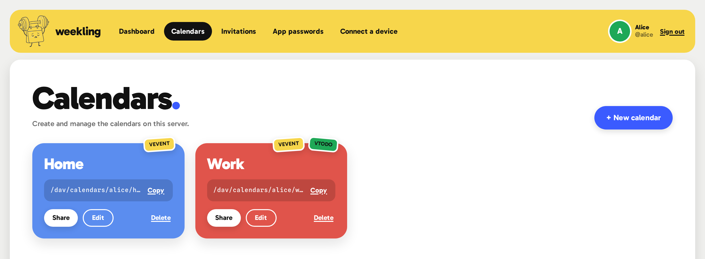

<p align="center">
  
</p>

<h1 align="center">weekling</h1>

<p align="center">
  <strong>A small, fast, self-hosted calendar server — stronger than it looks.</strong><br />
  CalDAV and a genuinely pretty admin UI, in a single Rust binary. Linux-first and NAS-friendly.
</p>

<p align="center">
  <a href="https://github.com/alex-poor/weekling/actions/workflows/ci.yml"></a>
</p>

<p align="center">
  
  
  
  
</p>

---

Weekling is the calendar server you can `docker run` on a Raspberry Pi in two minutes, hand to
your family, and forget about. It speaks just enough **CalDAV** for the clients real people use
(Apple Calendar, Thunderbird, DAVx⁵, GNOME Calendar…), ships a management UI that looks like it
belongs in this decade, and is **secure by default**.

It's built for **homes, families, and small teams** — not a groupware behemoth. One binary, one
SQLite file, no runtime to install.

<p align="center">
  
</p>

## ✨ What's inside

- 📅 **Core CalDAV** — service discovery, `PROPFIND`/`REPORT`, ETag-safe writes, and efficient
  `sync-collection`. Works with Apple Calendar, Thunderbird, DAVx⁵ and friends.
- 🤝 **Sharing** — share a calendar with another user as *can edit*, *can view*, or *free/busy only*.
- ✅ **Tasks & free/busy** — VTODO task lists and `free-busy-query`, right alongside events.
- 💌 **Scheduling (RFC 6638)** — invite people, and accept / decline invitations from the UI.
  iTIP REQUEST / REPLY / CANCEL are delivered between local users automatically.
- 🔔 **WebDAV-Push** — real, **encrypted Web Push** (RFC 8291 + VAPID) so DAVx⁵ syncs instantly
  instead of polling. Hardly any self-hosted server has this yet.
- 🔒 **Secure by default** — argon2id app passwords for clients, cookie+CSRF sessions for the UI,
  built-in **TLS** with automatic **Let's Encrypt** (ACME), and optional **OIDC single sign-on**.
- 🎨 **A lovely admin UI** — a SvelteKit "sticker sheet": lemon top bar, calendars as big colour
  slabs, die-cut badges. Create calendars, manage shares, mint app passwords, answer invites.
- 🪶 **Tiny & tidy** — a single static binary, SQLite storage, minimal dependencies, and a
  non-root, read-only-rootfs container.

## 🏃 Quick start

**Docker** (the easy way):

```sh
docker compose up --build
# open http://localhost:5232
```

Or run the prebuilt multi-arch image straight from GHCR:

```sh
docker run -p 5232:5232 -v weekling:/var/lib/weekling ghcr.io/alex-poor/weekling:latest
```

**From source:**

```sh
cargo run
# open http://localhost:5232  ·  probe: http://localhost:5232/healthz
```

Then create your first user and calendar:

```sh
weekling user add alice --display "Alice" --email alice@example.com
echo "a-strong-passphrase" | weekling user passwd alice   # UI login
weekling token add alice                                   # app password — copy it once
weekling calendar add alice "Home" --id home --color "#3b5bff"
```

## 🔌 Connect a device

Point any CalDAV app at `http://<host>:5232/` — it auto-discovers via `/.well-known/caldav`.

| | |
|---|---|
| **Server URL** | `http://your-server:5232/` |
| **Username** | your Weekling username |
| **Password** | an **app password** (never your account password) |

*Thunderbird:* New Calendar → On the Network → paste the URL. *Apple Calendar:* Add Account →
Other → CalDAV (Advanced). *Android:* DAVx⁵ → Login with URL + user name. The UI's **Connect a
device** page has copy-paste steps per client.

## 🛠 Admin CLI

```sh
weekling user add <name> [--display D] [--email E] [--admin]
weekling user passwd <name>                 # account password (reads stdin)
weekling token add <user>                   # app password (prints once)
weekling calendar add <user> <title> [--id ID] [--color #HEX] [--components VEVENT,VTODO]
weekling share add <owner> <cal> <grantee> [--access read|read-write|freebusy]
weekling help
```

## 🔒 TLS & SSO

Configure via `weekling.toml` or `WEEKLING_*` env vars (see
[`weekling.example.toml`](weekling.example.toml)):

- **`[tls] mode = "acme"`** — automatic Let's Encrypt certificate for your domain.
- **`[tls] mode = "files"`** — bring your own cert/key.
- **`[tls] mode = "off"`** — plain HTTP behind a reverse proxy (the default).
- **`[oidc]`** — delegate UI login to Authentik / Keycloak / Google via OpenID Connect.

## 📦 Deployment

- **Docker / Compose / NAS:** one volume (`/var/lib/weekling`), one port (`5232`). The image runs
  as a **non-root** user on a **read-only root filesystem**, all capabilities dropped. A named
  volume inherits the right ownership; for a bind mount, `chown 65532:65532` the host dir first.
- **systemd:** [`deploy/weekling.service`](deploy/weekling.service) — a hardened unit using
  `DynamicUser` + `StateDirectory`.
- Multi-arch (amd64 + arm64), distroless, tiny.

## 🧱 Built with

[Rust](https://www.rust-lang.org/) · [axum](https://github.com/tokio-rs/axum) · SQLite
([rusqlite](https://github.com/rusqlite/rusqlite)) · [rustls](https://github.com/rustls/rustls) ·
[SvelteKit](https://svelte.dev/). See [`DESIGN.md`](DESIGN.md) for the architecture and roadmap.

## 🧑‍💻 Development

```sh
cargo fmt --all
cargo clippy --all-targets -- -D warnings
cargo test
cargo deny check                      # supply-chain gate
cd ui && npm ci && npm run build       # rebuild the UI into web/
```

## 📄 License

[AGPL-3.0-or-later](LICENSE) — self-host freely; share your improvements.

<p align="center"><sub>Even a weekling starts with one rep. 🏋️</sub></p>
